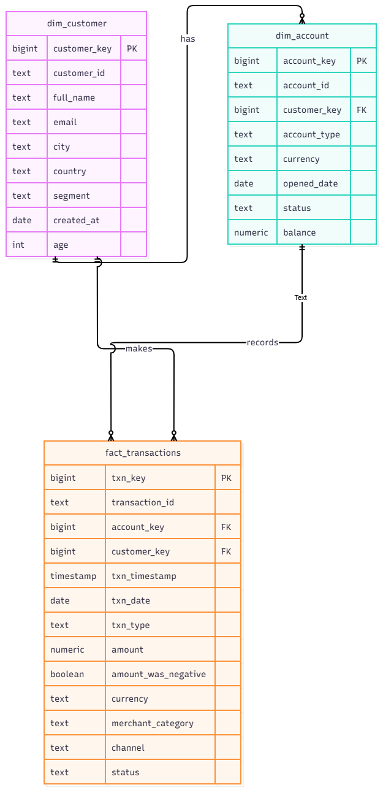

# Banking Data Platform

End-to-end data engineering project on synthetic banking data, built with a medallion architecture (bronze, silver, gold). The same pipeline is implemented twice: in SQL on PostgreSQL, and in PySpark.

## Architecture
- **Bronze:** raw synthetic customers, accounts and transactions, with deliberate quality issues (nulls, duplicates, negative amounts, inconsistent casing, orphan account IDs)
- **Silver:** cleaned data: duplicates removed, text standardised, types cast. Invalid rows go to `transactions_rejected` with a reason instead of being deleted
- **Gold:** star schema (`dim_customer`, `dim_account`, `fact_transactions`) plus reporting tables (`daily_txn_summary`, `customer_summary`)

## Star schema


Reporting amounts are kept per currency (AED, USD, EUR) and never added across currencies.

## Project structure
- `src/generate_data.py`: generates the bronze CSVs
- `src/bronze_to_silver.py`: PySpark silver layer
- `src/silver_to_gold.py`: PySpark gold layer
- `sql/`: the same layers in PostgreSQL SQL (quality checks, silver, gold)
- `notebooks/`: Colab notebook used to develop and validate the silver logic
- `docs/`: diagrams

## How to run (PySpark)
Needs Java 17 and Python. Easiest on Google Colab:

```
pip install faker pyspark
python src/generate_data.py
python src/bronze_to_silver.py
python src/silver_to_gold.py
```

Output is written to `data/bronze`, `data/silver` and `data/gold`.

## How to run (PostgreSQL)
1. Run `python src/generate_data.py`
2. Load the CSVs from `data/bronze` into schema `bronze` in a database
3. Run `sql/03_silver_layer.sql`, then `sql/04_gold_layer.sql`

## Data quality rules (silver)
- Duplicate IDs removed
- Names, emails and statuses standardised
- Negative amounts and balances flagged, then made positive
- Null amounts and orphan account IDs moved to `transactions_rejected`
- Check: good rows + rejected rows = unique bronze IDs

## Cloud mapping
| This project | Production equivalent |
|---|---|
| Local CSV / Parquet folders | Data lake (S3, ADLS) with Parquet or Delta |
| PySpark scripts | Databricks jobs, AWS EMR / Glue |
| PostgreSQL | Cloud warehouse (Synapse, Redshift, Snowflake) |
| Airflow (planned) | Managed Airflow, Azure Data Factory |

## Roadmap
Airflow orchestration, Power BI dashboard on the gold layer.